

<h1>Mahir Hasan Sifat</h1>

**I solve hard problems for fun, then build backends that keep them solved.**

Dhaka, Bangladesh &nbsp;·&nbsp; open to relocation and remote

 

## The arena

I've been competing since 2020, on every judge I could get an account on. Here's the full count, de-duplicated across all of them.

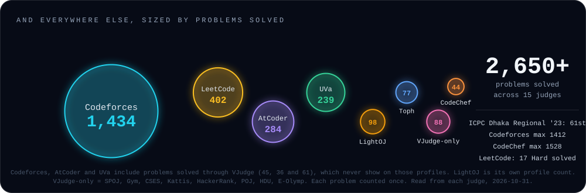

- **ICPC Asia Dhaka Regional 2023: [61st](https://bapsoj.org/contests/icpc-dhaka-regional-site-2023/standings).** Also 7th at the IUBAT Collaborative Contest 2023 and a BUET IUPC 2023 team.
- **VJudge counts too.** 45 Codeforces, 61 UVa and 36 AtCoder solves went through VJudge's own bot accounts, so they never show on those judges' profiles. They're all in the panel above, each problem counted once.

 

## From the other side of the scoreboard

I don't only compete, I run contests. In 2023 I was **Judging Director of the DIU Take-Off Programming Contest**: a 241-person main round, two preliminary slots and a 722-person mock round. I set one of the hardest problems (F, solved by 4 people) and reviewed another, and across contests I've set and tested 15+ problems. The whole editorial, with problem analyses and reference solutions, is public: **[Take-Off-Programming-Contest-Fall-2023 &rarr;](https://github.com/mahir-hs/Take-Off-Programming-Contest-Fall-2023)**

<a href="https://github.com/mahir-hs/Take-Off-Programming-Contest-Fall-2023"></a>

 

## Things I build

Every card links to the real repo, and Tetris links to a version you can play right now. Brain MRI is a private research repo, so that card doesn't link anywhere yet.

<table>
<tr>
<td width="50%"><a href="https://mahir-hs.github.io/notif-guardian/"></a></td>
<td width="50%"><a href="https://mahir-hs.github.io/Tetris/"></a></td>
</tr>
<tr>
<td width="50%"><a href="https://mahir-hs.github.io/lamplore/"></a></td>
<td width="50%"><a href="https://mahir-hs.github.io/Yomi/"></a></td>
</tr>
<tr>
<td width="50%"><a href="https://github.com/mahir-hs/ParcelTrack"></a></td>
<td width="50%"><a href="https://github.com/mahir-hs/GPS-Tracking"></a></td>
</tr>
<tr>
<td width="50%"><a href="https://github.com/mahir-hs/db-migrator"></a></td>
<td width="50%"><a href="https://github.com/mahir-hs/EMS"></a></td>
</tr>
<tr>
<td width="50%"></td>
<td width="50%"><a href="https://github.com/mahir-hs/DRL-Bounded_Knapsack_problem"></a></td>
</tr>
<tr>
<td width="50%"><a href="https://github.com/mahir-hs/WalletTopUpSystem"></a></td>
<td width="50%"><a href="https://github.com/mahir-hs/Story-Stream"></a></td>
</tr>
</table>

**The story behind Notif Guardian:** my Xiaomi phone kept delivering WhatsApp messages hours late. The usual advice is "enable autostart", and that wasn't the problem. On the device I traced it to HyperOS's *Millet* freezer cgroup-freezing Google Play services, the process that carries every push, the moment the screen turned off. It was missing from a system no-restrict list, and the OS rewrote that list whenever it liked. The app repairs it, and a tiny helper puts it back within about 20 ms each time the system wipes it. [Full write-up &rarr;](https://mahir-hs.github.io/notif-guardian/)

**More in the lab:** [Library Management](https://github.com/mahir-hs/library-management) (.NET API + Angular 19) · [LeetCode](https://github.com/mahir-hs/LeetCode) (C++ solutions) · [Code-Library](https://github.com/mahir-hs/Code-Library) (my C++ contest library) · [aws-learn](https://github.com/mahir-hs/aws-learn) and [ci-cd-learn](https://github.com/mahir-hs/ci-cd-learn) (learning in public) · [all repositories &rarr;](https://github.com/mahir-hs?tab=repositories)

 

## By day: making retries harmless

I work on payments, wallets and a large SQL Server to PostgreSQL migration for a travel platform. The recurring theme is making sure that doing something twice is the same as doing it once. Below is that idea in one loop: the first request goes through, the retry with the same key is stopped at Redis.


 

Competitive stats are read straight from each judge's data and drawn from the raw numbers.

