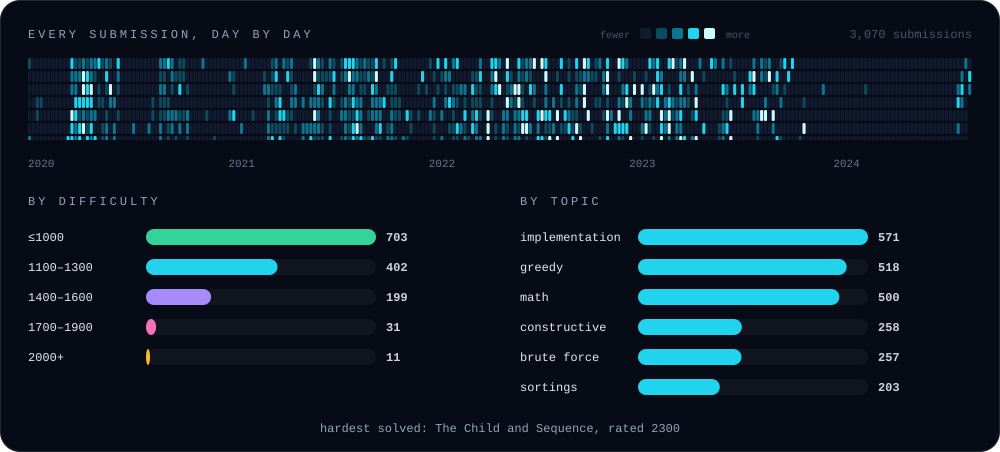

<h1>Mahir Hasan Sifat</h1>

**I solve hard problems for fun, then build backends that keep them solved.**

Dhaka, Bangladesh &nbsp;·&nbsp; open to relocation and remote

 

## The arena

I've been competing since 2020. This is what that looks like when you plot it, straight from the Codeforces API: 3,070 submissions and 120 rated contests, including the stretch where my rating collapsed and the climb back.

  

- **ICPC Asia Dhaka Regional 2023: [61st](https://bapsoj.org/contests/icpc-dhaka-regional-site-2023/standings).** Also 7th at the IUBAT Collaborative Contest 2023 and a BUET IUPC 2023 team.
- **42 problems rated 1700 or higher**, the hardest at 2300, from a rating that once sat at 517.
- **96% C++.** Peak hours are 8 to 10 PM Dhaka time, and the busiest month was April 2020 with 168 submissions.
- **2,500+ problems and 300+ contests** across eight judges: Codeforces, CodeChef, AtCoder, LeetCode, LightOJ, Toph, UVa and VJudge. Codeforces alone accounts for 1,389 of them.
- I also set and tested 15+ contest problems as Judging Director of the DIU Take-Off Programming Contest.

 

## Things I build when nobody's asking

### [Notif Guardian](https://github.com/mahir-hs/notif-guardian) &nbsp;Kotlin · Jetpack Compose
My Xiaomi phone kept delivering WhatsApp messages hours late. The usual advice is "enable autostart", and that wasn't the problem. So I went digging on the device and found the real culprit: HyperOS's *Millet* freezer was cgroup-freezing Google Play services, the process that carries every push notification, the moment the screen turned off. It was missing from a system no-restrict list, and the OS rewrote that list whenever it liked. Notif Guardian repairs it, and a tiny helper app puts it back within about 20 ms each time the system wipes it.
**[How it works &rarr;](https://mahir-hs.github.io/notif-guardian/)**

### [ParcelTrack](https://github.com/mahir-hs/ParcelTrack) &nbsp;.NET 10 · Kafka · Postgres · Redis · YARP
Six microservices that follow parcels across Pathao, Steadfast and RedX: a gateway, a shipment service on Clean Architecture and CQRS with a transactional outbox, circuit-breaker polling, and HMAC-signed webhooks. A playground for the part of distributed systems nobody draws on the whiteboard: what happens on the retry.

### [GPS-Tracking](https://github.com/mahir-hs/GPS-Tracking) &nbsp;Go · MQTT · TimescaleDB · WebSocket
Devices publish over MQTT, positions land in TimescaleDB, and clients watch them move live over WebSocket. All of it runs from one `docker compose up`.

### Brain MRI &times; graph neural networks &nbsp;Python · PyTorch Geometric
Each scan becomes a 256-node graph and a GATv2 classifies four tumour types at 98.78%. Then I found my first train/test split had leaked near-duplicate images, threw out the flattering number and rebuilt the evaluation properly. I trust the honest one more.

 

## By day: making retries harmless

I work on payments, wallets and a large SQL Server to PostgreSQL migration for a travel platform. The recurring theme is making sure that doing something twice is the same as doing it once. Below is that idea in one loop: the first request goes through, the retry with the same key is stopped at Redis.

 

Competitive stats are pulled from the Codeforces API and regenerated from the raw submission data.

