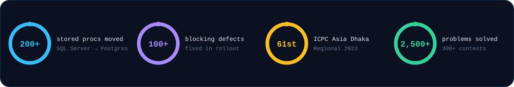

## About

I build the backend parts that have to be right: payments, wallets, concurrency, migrations and event pipelines. Day to day that's **.NET and PostgreSQL** on a B2B/B2C online travel platform. On the side I chase problems until I find the actual root cause, and I like writing it up so the next person doesn't have to.

I came up through competitive programming (ICPC, Codeforces, CodeChef), so I still think in complexity and edge cases first. I'm **open to relocation and remote work**.

## What I've shipped

The reliability work in one loop: the first request goes through, the retry with the same key is stopped at Redis.

- **PostgreSQL migration** &mdash; moved 200+ SQL Server stored procedures to PostgreSQL functions across booking, ticketing, refunds and accounting, with behaviour parity against the legacy system. Then stabilised the rollout by fixing 100+ release-blocking defects across payments, invoicing and financial reports.
- **Money-safe concurrency** &mdash; Redis-backed idempotency service and a fault-tolerant distributed lock manager. Fixed race conditions in agent wallet top-up approval by redesigning the database locking.
- **Event-driven notifications** &mdash; Kafka pipeline with FCM push delivery supporting single-user, group and exclusion-based targeting.
- **Shared data-access layer** &mdash; one abstraction over EF Core and Dapper across SQL Server and PostgreSQL, used by the team's services.
- **Security** &mdash; TOTP two-factor authentication, and browser-fingerprint validation on login and token refresh against session hijacking.
- **Performance** &mdash; used APM traces to find slow endpoints, then fixed them through execution-plan analysis.

## Things I'm building

### [Notif Guardian](https://github.com/mahir-hs/notif-guardian) &nbsp;Kotlin · Jetpack Compose · Android
Notifications from WhatsApp, Telegram and Gmail arriving late on Xiaomi, Redmi and POCO phones is a known, annoying problem, and "turn on autostart" doesn't fix it. I traced it on a real device to HyperOS's *Millet* freezer cgroup-freezing Google Play services (the FCM host) on screen-off, because it was missing from the system's no-restrict list. Notif Guardian detects and repairs that. A small helper app re-adds protected apps within about 20 ms whenever the system rewrites the list.
**[Read the write-up and docs &rarr;](https://mahir-hs.github.io/notif-guardian/)**

### [ParcelTrack](https://github.com/mahir-hs/ParcelTrack) &nbsp;.NET 10 · PostgreSQL · Kafka · Redis · Keycloak · YARP
Multi-carrier parcel tracking for Bangladeshi couriers (Pathao, Steadfast, RedX). Six services: a YARP and Keycloak gateway, shipment (Clean Architecture and CQRS with a transactional outbox), tracking with Polly circuit breakers, notifications, and HMAC-signed webhook dispatch. A learning project where I worked through failure semantics properly instead of just drawing boxes.

### [GPS-Tracking](https://github.com/mahir-hs/GPS-Tracking) &nbsp;Go · MQTT · TimescaleDB · Redis · WebSocket
Device location ingestion over MQTT into TimescaleDB, streamed live to clients over WebSocket, all in Docker Compose.

### Research &mdash; brain MRI tumour classification with graph neural networks
Four-class classification by modelling each MRI as a 256-node patch graph (GATv2). Reached 98.78% mean accuracy over three seeds, then found that the first image-level split leaked near-duplicates and rebuilt the evaluation with duplicate-group-aware splits, shuffled-edge controls and leave-one-source-out testing. I trust the lower, honest number more than the first flattering one.

## Toolbox

**Patterns I reach for:** Clean Architecture · CQRS · transactional outbox · idempotency keys · distributed locking · event-driven design · Testcontainers-backed integration tests

## Competitive programming

| Where | Result |
|---|---|
| ICPC Asia Dhaka Regional 2023 | **61st place** |
| IUBAT Collaborative Contest 2023 | 7th place |
| Codeforces | Specialist, max rating **1412** |
| CodeChef | 3&#9733;, max rating **1606** (best rank 85th, top 0.3%) |
| Overall | 300+ contests, 2,500+ problems solved across Codeforces, CodeChef, AtCoder, LightOJ, UVa, Toph and LeetCode |

I also served as Judging Director of the DIU Take-Off Programming Contest (set and tested 15+ problems) and teach DSA classes.

## Education and languages

**BSc in Computer Science and Engineering**, Daffodil International University, 2020&ndash;2024, CGPA 3.66/4.00.
Bangla (native) · English (IELTS Academic 7.0) · German (learning)

## Say hello

